<p align="center">
  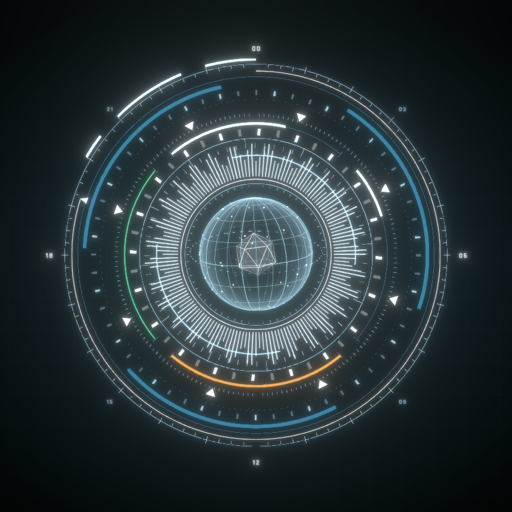
</p>

<p align="center">
  
</p>

<p align="center"><b>A JARVIS-style command center for your AI agents, built in Rust.</b></p>

<p align="center">
  <a href="https://github.com/xiaojia630/sphere/releases/latest"></a>
</p>

<p align="center">
  
  
  
</p>

<p align="center">
  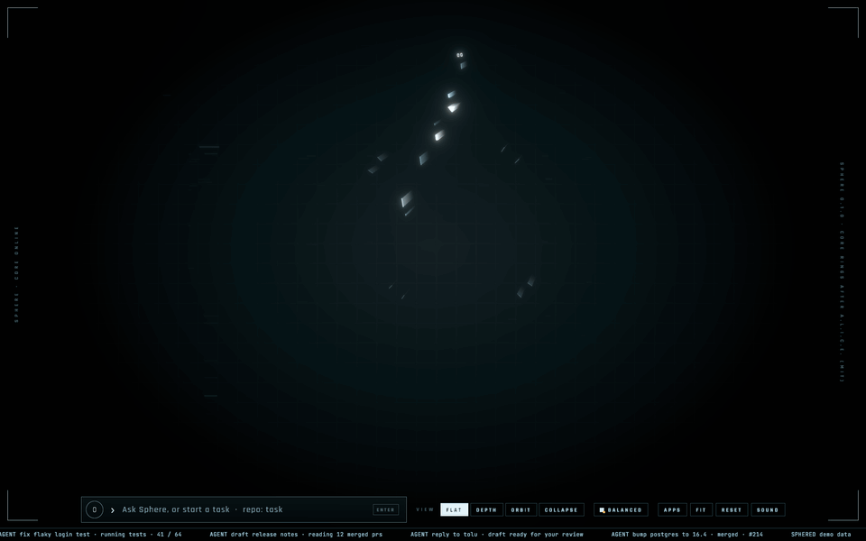
</p>

Sphere is a desktop for working with coding agents. A live core sits at the centre of the screen with glass panels
around it. You start Claude Code agents from a command bar and watch them work. When one needs you, the request
rises out of the core and you answer it with a key. Around that sit the apps a developer reaches for all day,
all on your real data: code review, git, containers, ports, system and files.

## See it in action

<p align="center">
  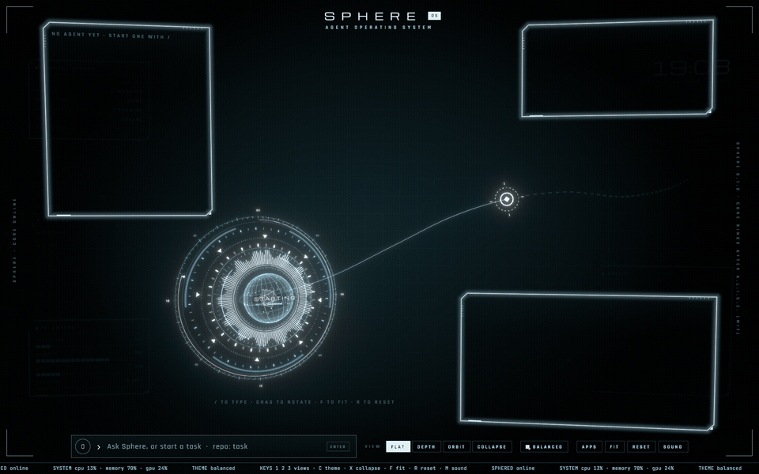<br>
  <sub><b>Watch an agent work.</b> Steps stream along a track from the core while the run, output and edit panels follow along.</sub>
</p>

<p align="center">
  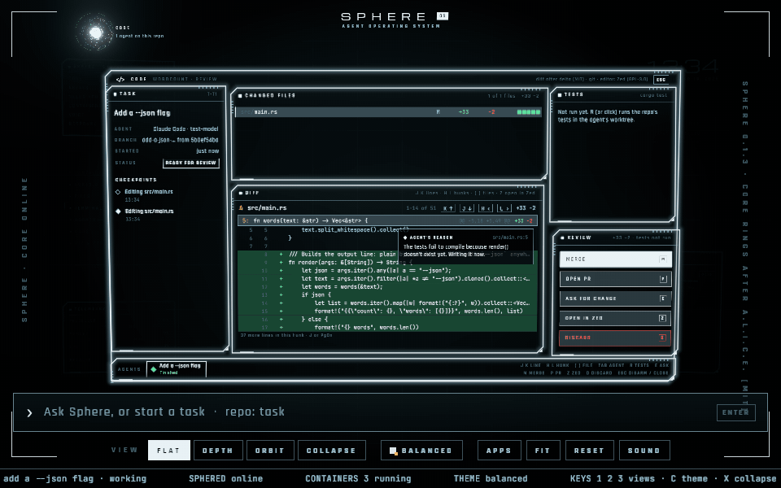<br>
  <sub><b>Review before it lands.</b> The diff by hunk with the agent's reason pinned, the tests in its worktree, then merge.</sub>
</p>

<p align="center">
  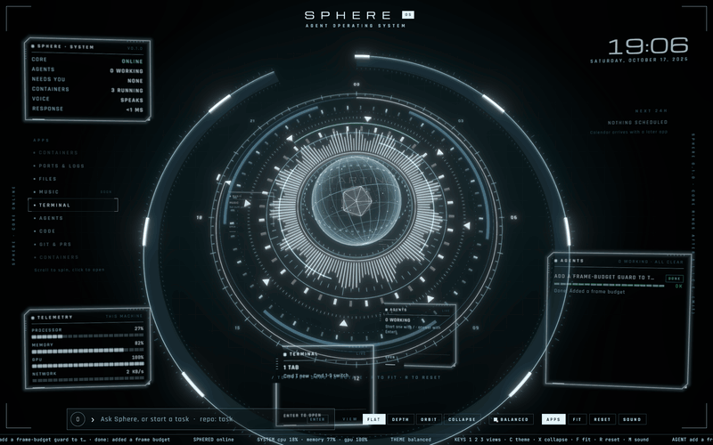<br>
  <sub><b>Open the core.</b> Your apps orbit it. Spin, pick one, and the core shrinks to the corner to make room.</sub>
</p>

<p align="center">
  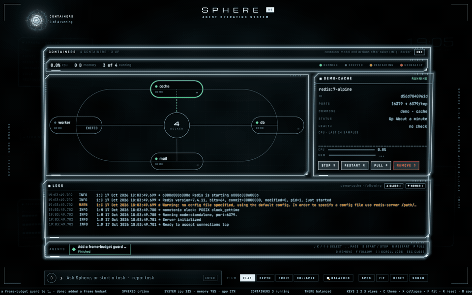<br>
  <sub><b>Everything running on your Mac.</b> Docker or OrbStack containers with their logs, and every port that's listening.</sub>
</p>

## The apps

<table>
  <tr>
    <td width="50%">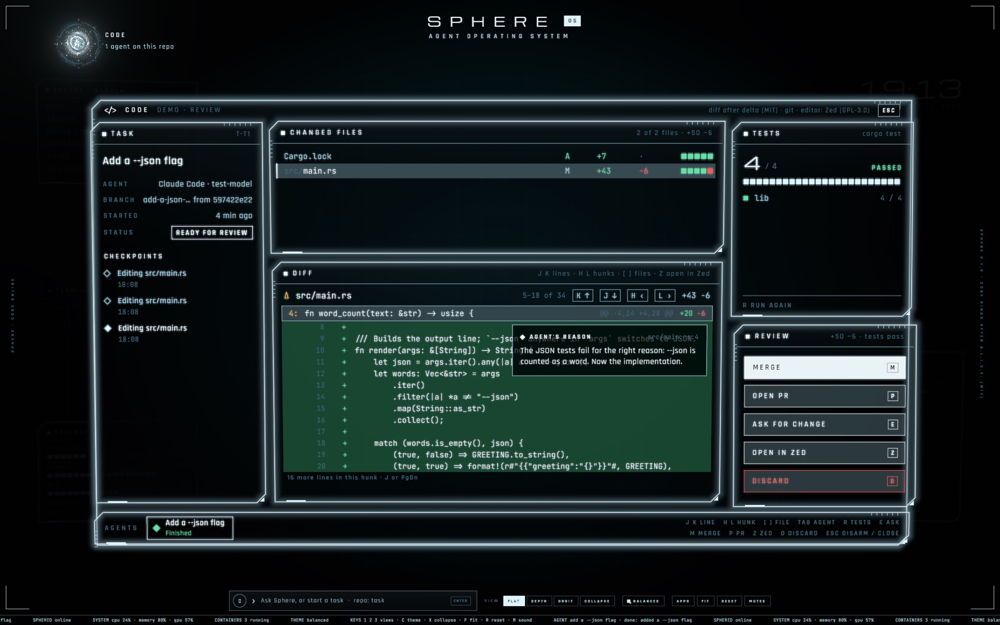<br><b>Code</b>: review an agent's diff with its reasons, run the tests, then merge, open a PR or ask for a change. Or open a folder (`code ~/Projects/x`, `code .`, <kbd>O</kbd> in Files or Git): its tree, files and uncommitted diffs, <kbd>E</kbd> edits in Helix in a terminal tab, <kbd>Z</kbd> opens Zed.</td>
    <td width="50%">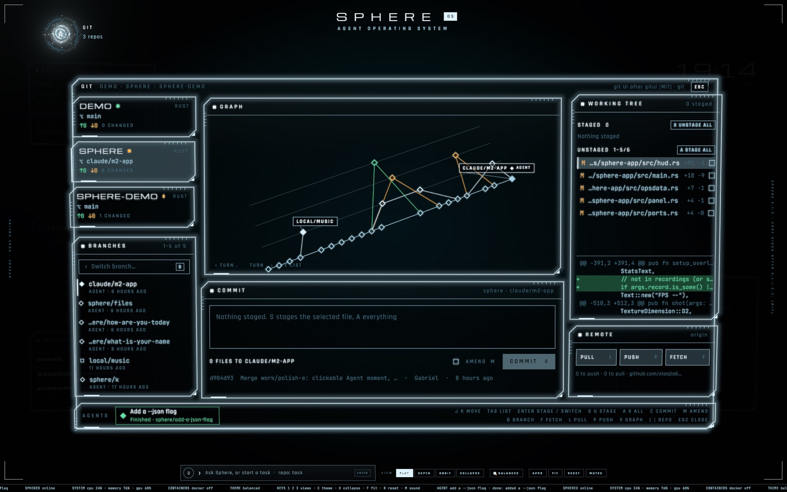<br><b>Git</b>: your repos, a tilted commit graph, staging, commit, branches, pull, push and fetch.</td>
  </tr>
  <tr>
    <td width="50%">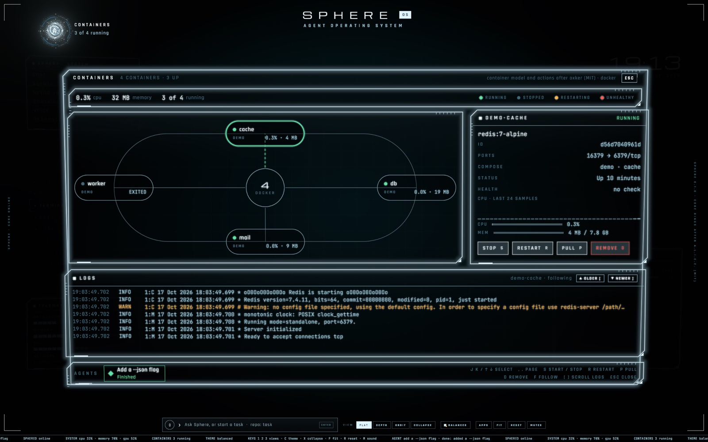<br><b>Containers</b>: start, stop, restart, pull and remove, with logs that follow.</td>
    <td width="50%">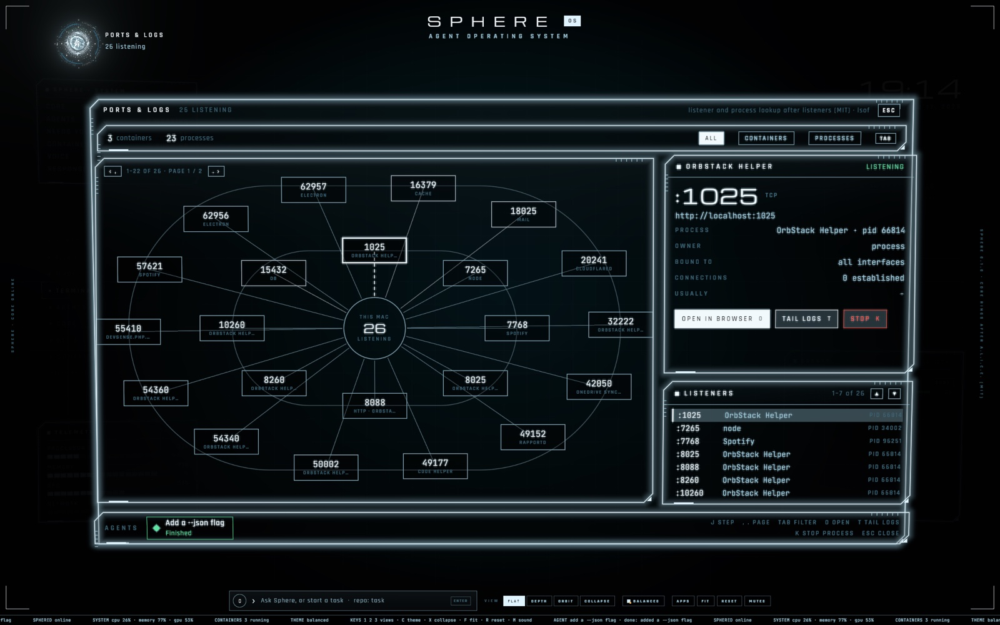<br><b>Ports & logs</b>: every listening port, matched to the process or container that owns it.</td>
  </tr>
  <tr>
    <td width="50%">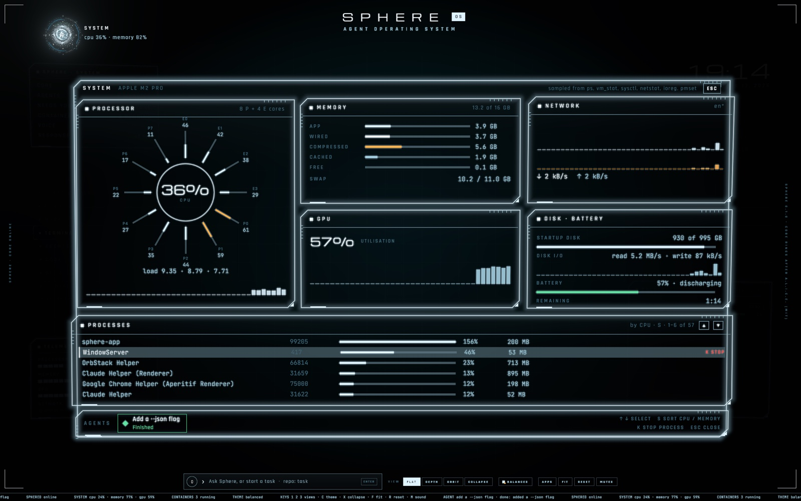<br><b>System</b>: CPU per core, memory, GPU, network, disk and battery, and what's using them.</td>
    <td width="50%">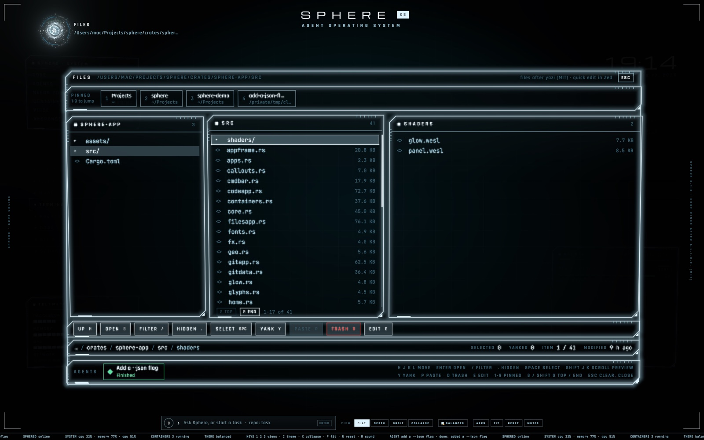<br><b>Files</b>: yazi-style columns with a preview, pinned places, copy and paste, and the Trash. <kbd>E</kbd> edits in Helix, <kbd>Z</kbd> opens Zed, <kbd>O</kbd> opens the folder in Code.</td>
  </tr>
</table>

## Protocols

Write a routine as one line in the command bar and Sphere runs it as a normal agent task on that schedule, even while
the app is closed. What it finishes waits for your review like any other task.

```
every weekday 9:00 sphere: update the dependencies, run the tests and fix what breaks
```

Schedules are in your local time: `every day 9:00`, `every mon,wed,fri 18:30`, `every 2 hours`, `tomorrow 9:00`,
`in 45 minutes`. The bar shows when a line will next run before you press Enter, `protocols` opens the list (switch
one off, run it now, remove it), and the Next 24h panel on the home screen shows what is coming. A run is skipped while
the last one is still going.

## Install

1. Download the latest `Sphere-<version>.dmg` from [Releases](https://github.com/xiaojia630/sphere/releases), open
   it and drag Sphere to Applications.
2. The first time, right-click Sphere and choose **Open**. The app isn't notarized by Apple yet, so a plain
   double-click is refused once. If macOS still won't open it, run
   `xattr -dr com.apple.quarantine /Applications/Sphere.app`.
3. That's it. Sphere starts its background service by itself and keeps its state in `~/.sphere`.

**Requirements:** macOS 13 or later on Apple silicon. Agents run on your own
[Claude Code](https://docs.anthropic.com/en/docs/claude-code), which must be installed and signed in; everything
else works without it. Optional: Docker Desktop or [OrbStack](https://orbstack.dev) for Containers, the GitHub CLI
(`gh`) for opening PRs, [Helix](https://helix-editor.com) for quick edits and [Zed](https://zed.dev) for real ones.

## Keys

| Key | What it does |
| --- | --- |
| <kbd>Option</kbd> <kbd>Space</kbd> | Show or hide Sphere from anywhere. Closing the window hides it; <kbd>Cmd</kbd> <kbd>Q</kbd> quits. |
| <kbd>/</kbd> or <kbd>Cmd</kbd> <kbd>K</kbd> | The command bar. `repo: what to do` starts an agent in its own worktree; `> message` talks to it; `every weekday 9:00 repo: what to do` saves a protocol; `protocols` lists them. |
| <kbd>A</kbd> | Open the core: the app orbit. <kbd>←</kbd> <kbd>→</kbd> spin, <kbd>Enter</kbd> opens, <kbd>Esc</kbd> goes back. |
| <kbd>W</kbd> / <kbd>N</kbd> | The Working view / what needs you. <kbd>Enter</kbd> says yes, <kbd>E</kbd> changes, <kbd>L</kbd> is later; <kbd>A</kbd> says yes and saves the rule the agent suggested, <kbd>Shift</kbd> <kbd>Enter</kbd> says yes to every other agent asking exactly the same. |
| <kbd>T</kbd> | The terminal. Its tabs survive quitting the app. |
| <kbd>Cmd</kbd> <kbd>Enter</kbd> | **Fix it**, in the terminal, when a command just failed inside a git repo: an agent gets the command, the folder, the exit status and the end of its output, and fixes it in its own worktree, or in your working copy when the repo has changes you haven't committed. |
| <kbd>1</kbd> <kbd>2</kbd> <kbd>3</kbd> · <kbd>C</kbd> · <kbd>M</kbd> | Flat, depth and orbit views · cycle the five themes · mute. |

Every app lists its own keys in its corner. Every button and row can be clicked, and the wheel scrolls what's under
the pointer. Anything destructive asks twice.

## Build from source

```sh
cargo build --release
target/release/sphere-app                  # starts sphered when it isn't running
sh scripts/package-macos-app.sh            # target/Sphere.app, a .dmg and a .zip
```

## Credits

The apps adapt the designs of these open-source projects:
- [yazi](https://github.com/sxyazi/yazi) (Files)
- [gitui](https://github.com/extrawurst/gitui) (Git)
- [oxker](https://github.com/mrjackwills/oxker) (Containers)
- [listeners](https://github.com/GyulyVGC/listeners) (Ports & logs)
- [delta](https://github.com/dandavison/delta) (diffs)
- [herdr](https://github.com/herdrdev/herdr) (the process holder)

They are all MIT or Apache-2.0.

Sphere is built on [Bevy](https://bevy.org), [Alacritty](https://github.com/alacritty/alacritty)'s terminal core,
[WezTerm](https://github.com/wezterm/wezterm)'s `portable-pty` and [rodio](https://github.com/RustAudio/rodio).
It is set in Michroma, Rajdhani and JetBrains Mono (SIL OFL).
The scripts that let the terminal see where a command starts and ends (`crates/sphere-app/assets/shell`) adapt
[VS Code](https://github.com/microsoft/vscode)'s shell integration (MIT, Copyright (c) Microsoft Corporation).

Sphere's voice is [Kokoro-82M](https://huggingface.co/hexgrad/Kokoro-82M) by hexgrad (Apache-2.0) with its `bm_george`
voice, run through [ONNX Runtime](https://onnxruntime.ai) (MIT) via [`ort`](https://github.com/pykeio/ort) (MIT/Apache-2.0).
The model file is [kokoro-onnx](https://github.com/thewh1teagle/kokoro-onnx)'s int8 export (MIT), downloaded on first
use; phonemes come from [misaki](https://github.com/hexgrad/misaki)'s British lexicons (Apache-2.0). If
[espeak-ng](https://github.com/espeak-ng/espeak-ng) is installed, it is run as a separate program for words the
lexicons don't know; it is not linked or included.

Sphere is licensed under Apache-2.0; see [LICENSE](LICENSE) and [NOTICE](NOTICE). Contributions are welcome: see [CONTRIBUTING.md](CONTRIBUTING.md).

---

## For developers

### sphered, the service

`sphered` is the background service behind Sphere. It starts and owns Claude Code agents (headless, over stream-json), gives each task its own git worktree and branch, records everything as one ordered event log in SQLite, and turns the agent's permission checks, questions and plans into requests that only you answer. Clients talk to it over a Unix socket with JSON-RPC 2.0; the `sphere` CLI is the first one.

The design is in [docs/sphered.md](docs/sphered.md). The service and CLI run on macOS and Linux; the app is macOS-first.

### Crates

| Crate | What it is |
| --- | --- |
| `sphere-proto` | Events, requests, the JSON-RPC API types and the shared views. |
| `sphere-host` | A tiny detached process that owns agent processes and their output files, so `sphered` can restart without touching a running agent. |
| `sphered` | The service: store, hub, policy, workspaces, supervisor, API server. |
| `sphere-client` | Async client library. |
| `sphere-cli` | The `sphere` binary. |
| `sphere-app` | The desktop app (`sphere-app`): core, panels, command bar, terminal tabs, Agent moment. |
| `fake-claude` | A scripted stand-in for `claude`, driven by the fixtures in `crates/fake-claude/fixtures`. Used by the tests. |

### Build and install

You need a recent stable Rust toolchain and git. To run real agents you need Claude Code installed and signed in.

```
cargo build --release
install -m755 target/release/{sphere,sphered,sphere-host,sphere-app} ~/.local/bin/
sphere doctor
```

`sphere doctor` checks Claude Code (version range and sign-in), git, the sandbox helpers (`bwrap`, `socat`) and whether sphered is running. Version and sign-in problems are warnings, never errors.

### The CLI

```
sphere daemon                       run sphered in the foreground
sphere run <repo> "<task>"          start an agent in a new worktree and branch (sphere/<slug>)
    --in-place --budget 2 --title T --mode plan --allow-rewrites --follow
sphere ls                           tasks, and what is waiting on you
sphere watch [task] [--typing]      follow live (a task is replayed from its start)
sphere answer <request> yes|change|later [text] [--always] [--input JSON]
sphere send <task> "<message>"      talk to the agent
sphere interrupt <task>             end the current turn
sphere stop <task>                  interrupt, then SIGTERM, then SIGKILL after a grace period
sphere mode <task> <mode>           change the permission mode
sphere model <task> <model>         change the model
sphere sessions                     Claude Code sessions on this machine
sphere bring-in <session>           continue a session as a Sphere task (refused while it runs elsewhere)
sphere remember "<note>" [--all]    tell every agent started in this repo (--all: in any repo) something, like "use pnpm, never npm"
sphere memory [rm <id>]             the notes by repo, with their ids; rm removes one
sphere protocol add "<text>"        save a protocol: "every weekday 9:00 sphere: update the dependencies"
    --repo R                        the repo for a line that names none (default: this folder)
sphere protocol list                protocols, when they run next, how the last run went
sphere protocol on|off|rm|run <id>  switch it on or off, delete it, or run it now
sphere doctor                       check the installation
```

`--socket` points the CLI at another sphered. By default the socket is in `$XDG_RUNTIME_DIR/sphere/` (else `~/.sphere/run/`).

### Answers

`yes` allows (optionally with an edited input; `--always` also saves the suggested rule), `change` refuses and tells the agent what to do instead, `later` snoozes the request. The first answer wins; any other gets `already_answered`. Stopping or interrupting a task withdraws its open requests. Answers are refused from any process an agent started, and from clients that identify as the assistant.

### Configuration

`~/.sphere/config.toml` (unknown keys are an error). The useful ones: `agent_command` (default `claude`), `max_concurrent` (3), `default_budget_usd` (5.0), `daily_cap_usd`, `stop_grace_ms`, `idle_ttl_ms` (idle agents stay warm for 10 minutes and hold no slot). The agent command is never read from a global environment variable.

### Policy

`~/.sphere/policy.toml` and a repo's `.sphere/policy.toml` are compiled into the agent's `--settings` (permission rules plus `sandbox.enabled`, on by default), plus `[[auto]]` rules that Sphere itself decides (for example `git push origin {branch}`). A repo policy can only add restrictions unless the user file says `trust_repos = true`. The sandbox can reach the package registries (crates.io, npm and Yarn, PyPI, the Go module proxy) by default, so installs and builds don't stop to ask; `[sandbox] allowed_domains` adds more hosts, and publishing still asks. Force pushes and history rewrites are denied unless a task starts with `--allow-rewrites`.

A repo's `.sphere/config.toml` can list files to `copy` into each worktree and a `setup` command to run there.

### Tests

```
cargo test --workspace
cargo clippy --all-targets
```

The integration tests start the real `sphered` and `sphere-host` binaries on temporary directories with `fake-claude` as the agent, including killing sphered mid-run and restarting it.

### Live smoke test (ignored by default)

`crates/sphered/tests/live_claude.rs` runs one real agent with a five cent budget and a one-word prompt. It needs `claude` installed and signed in, and it spends a few cents, so it is never part of a normal run:

```
cargo test -p sphered --test live_claude -- --ignored --nocapture
```

Set `SPHERE_LIVE_CLAUDE` to the command if `claude` is not on your PATH.

### The desktop app

`sphere-app` is the desktop app: the core, the glass panels, a command bar, terminal tabs and the Agent moment card. It is a client of sphered like the CLI, and starts sphered when nothing is running.

    cargo build --release
    target/release/sphere-app

More keys:

- `/` or Cmd+K: the command bar. A task starts an agent (`repo: task` picks the repo, a folder in `~/Projects` or a path; otherwise the last repo used, otherwise the app's folder) and opens the Working view. `> message` talks to the agent you heard from last, `stop` stops it. A line that starts with a schedule (`every weekday 9:00 sphere: update the dependencies`) is saved as a protocol instead, with a preview of its next run as you type; `protocols` opens them. The prototype's commands work too: `depth`, `orbit`, `collapse`, a theme name, `fit`, `reset`, `apps`, `open terminal`.
- Views: 1 Flat, 2/D Depth, 3/O Orbit, E Depth and Flat, X collapses the rings onto the sphere, F fits, R resets everything, C cycles the five themes, M mutes.
- Mouse: drag the core to turn it, drag panels anywhere, scroll to zoom (on a panel: push it back; on Apps: spin the rolodex), double-click the sphere to collapse, a ring to fold it, empty space to fit.
- A (or hold the sphere, or the dock's Apps): core open, the app orbit. ← → or scroll spins it, Enter or a click opens an app, Esc closes.
- S: the Agent swarm, every agent at once on one orbit per repo. Hover an agent for its recent steps, click it (or 1-9, Tab) to bring it forward, N for the next one that needs you, T shows every track, Esc goes back.
- W: the Working view on the latest agent (it also opens when you start one). P interrupts its turn, T brings its output forward, Esc goes home.
- N: the Agent moment for what needs you (it rises by itself when a request arrives). Enter answers yes, E changes (type, Enter), L is later, ← → steps through them, Esc puts them away. A permission that comes with a rule to remember has an Always button (A): yes, and the rule it names is saved to your policy. When other agents wait on exactly the same ask (the same tool and input), the card says so and Shift+Enter (Allow all) answers yes to all of them at once. Sphere reads each one out. The home's Needs you row and the swarm's status line say how long agents have waited on you today.
- Memory: a correction you give once can reach every agent after it. `remember: use pnpm, never npm` in the command bar keeps a note for the last repo used (`remember <repo>: …` for another, `remember all: …` for every repo), and after you send a Change on the Agent moment, a chip offers R to keep it as a note. Each agent sphered starts in that repo is told the notes (repo's own first, newest first), and the Working view tags the task `BRIEFED · 3`. `memory` in the command bar opens the notes by repo with their age and where they came from: ↑ ↓ or J K choose, D twice removes, Esc closes.
- Terminal: T focuses it, Esc releases it, Cmd+T new tab, Cmd+W close, Cmd+1..9 switch, Cmd+V paste. Tabs run your login shell inside sphere-host, so they survive the app closing: the next launch re-attaches them (replaying their output). If the host can't be reached they live in the app.
- Fix it: zsh and bash tabs start with a small shell integration (written to `~/.sphere/shell`; `SPHERE_SHELL_INTEGRATION=0` turns it off, any other shell runs as before) that tells the terminal where each command starts and ends, with its exit status and folder. Each tab's shell gets a secret that every one of those marks carries (it is removed from the environment before your startup files run, and a tab found again after the app restarts keeps it), so a program that only prints escape codes can't pass for a command. When a command fails inside a git repo (not when you stop it with Ctrl+C or Ctrl+Z, nor when a grep or a diff just says no), a slim amber strip rises at the bottom of the terminal, such as `cargo test · exit 101 · 3.2 s`. Cmd+Enter or FIX IT starts an agent in that repo (the command bar's path, titled `Fix: <command>`) and opens the Working view; its prompt has the command, the folder inside the repo, the exit status, how long it took and the end of the output. DISMISS puts the strip away, and the next command does too. The agent works in a worktree of its own, made from the last commit. When the repo has changes you haven't committed (new files count, ignored ones don't), it works in your working copy instead, so a failure that comes from them is in front of it, and its prompt tells it to keep them.
- Motion: transitions play Fast by default (apps, the Working view, the Agent moment and the app orbit settle in about a fifth of a second). `motion cinematic` in the command bar brings back the slower original timing, `motion fast` returns, and `motion` alone switches. `motion 1.5` plays Fast 1.5 times quicker still (0.25 to 4). The choice is remembered.
- Option+Space (macOS) brings Sphere up over anything and hides it again. When something needs you while Sphere isn't in front, you get a notification.

Sounds are synthesised and rendered to WAV (`crates/sphere-app/assets/sounds`). Speech uses macOS `say` with the Daniel voice.

Flags: `--demo` (sample agents, no service), `--code`, `--git`, `--app containers|ports|system|files`, `--moment` (the Agent moment with sample requests), `--memory card|armed|chip` (the notes card, with Remove armed, or the Agent moment just after a Change), `--protocols card|armed|empty|rail|tags|bar|mistake` (sample protocols: the card, with Remove armed, or empty; the Next 24h rail; the PROTOCOL tags; a line typed in the command bar, or a mistyped one), `--apps` (core open), `--work` (the Working view), `--swarm` (the Agent swarm), `--orbit`, `--collapsed`, `--theme <name>`, `--motion fast|cinematic`, `--fixit strip|after` (the terminal shows a failed `cargo test` with Fix it's strip, or plays pressing FIX IT), `--live` (screenshots and benches against the real service), `--cmd "<command>"` (what the first terminal tab runs), `--bench <seconds>`, `--shot <png> [--frames N] [--depth] [--term]`, `--record <dir> [--record-frames N]` (every frame, for GIFs), `--size WxH`, `--no-msaa`. `SPHERE_STATS=1` prints startup timings and memory. `SPHERE_SOCKET` points the app at another sphered. `SPHERE_CODE_DIR=<folder>` opens Code on that folder at start (look tests; `SPHERE_CODE_KEYS` plays keys in it).

`--shot` and `--record` render offscreen and need no window. `--bench`, `--shot` and `--record` use the demo data unless `--live` is given.

Linux: needs X11 dev libs by default (`--features wayland` for Wayland). The hotkey and notifications are macOS only for now. No GPU (CI, containers): `scripts/shot-swiftshader.sh --shot out.png --frames 120 --no-msaa` uses a software Vulkan driver.
