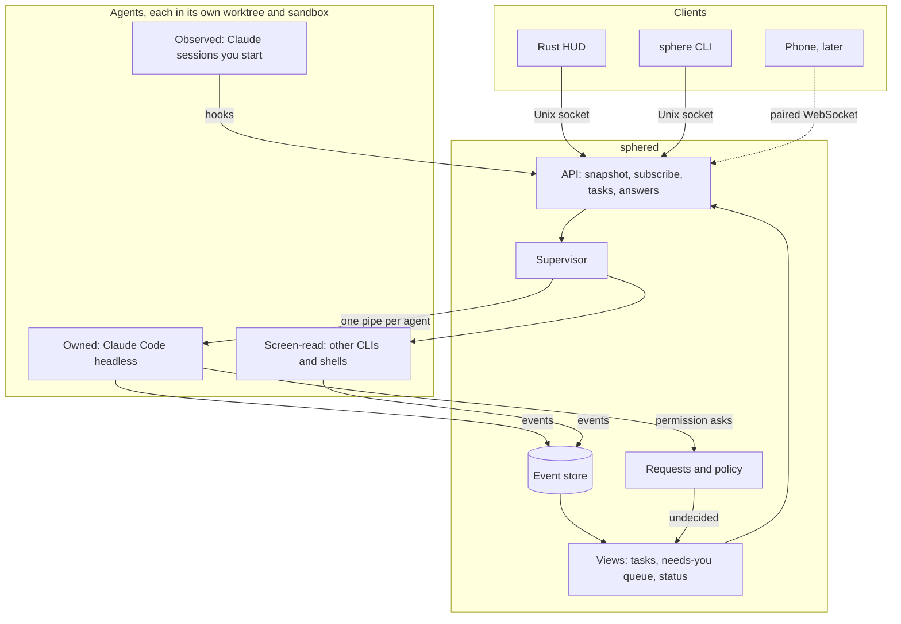

# sphered architecture

*Agreed with Gabriel on 2026-10-16. Milestone 1 is being built against this document.*

`sphered` is the system service of Sphere OS. It owns everything that has to outlive a window: the agents and terminals, their history, and the questions they're waiting on you for. The HUD, the `sphere` CLI, your phone later, and the agents themselves are all clients of it. If the HUD crashes or restarts, nothing is lost and no agent notices.

## Principles

1. **One source of truth.** Every change is an event in one ordered log. Task state, the step track, the needs-you queue and status lines are views computed from it. Any client can catch up from a sequence number.
2. **Reuse Claude Code, don't rebuild it.** sphered drives your installed Claude Code with your login, settings, CLAUDE.md files, MCP servers and plugins. What it adds is supervision, history and the human loop.
3. **Ask the human only what rules can't decide.** Most permission checks are settled inside the agent, some by sphered's rules, and only the rest become Agent moment cards.
4. **Answer from state, not from a model.** "What's it doing?" and "what needs me?" are lookups that return in under a millisecond. That is what will make voice feel instant.
5. **Every client is equal.** The HUD has no private API. Anything it can do, the CLI and agents can do through the same calls, within their permissions.

## Shape



## How sphered drives agents

There are three ways an agent can be connected, from most to least control.

| | what | how | events | answering | when |
|---|---|---|---|---|---|
| **Owned** | tasks sphered starts | Claude Code headless, with sphered as the SDK host | everything: each tool call and result, diffs, the todo plan, live text, cost | on the same pipe | M1 |
| **Observed** | Claude sessions you start yourself, in a terminal or with `claude --bg` | found with `claude agents --json`; hooks installed once in your Claude settings report to sphered | tool calls, needs you, done | through the permission hook | M2 |
| **Screen-read** | other CLI agents (Codex, Gemini CLI, Aider, opencode) and plain shells | run in a PTY that sphered holds, with herdr-style rules that read the screen | working, needs you, done | by keystroke | M2 |

**Owned agents: sphered as the SDK host.** sphered talks to Claude Code the same way Anthropic's own Agent SDKs do:

```
claude -p --input-format stream-json --output-format stream-json --verbose \
  --include-partial-messages --permission-prompt-tool stdio \
  --settings <generated> --max-budget-usd <budget> [--resume <session>]
```

- Your prompt and any follow-ups are written to stdin as user messages, so `send` can talk to a running agent.
- Every step, result and live text chunk comes back on stdout.
- When Claude Code needs permission, it sends a `can_use_tool` request on the same pipe, carrying the tool, its exact input and suggested "always allow" rules. sphered answers allow (optionally with edited input) or deny (with a message the agent reads).
- Interrupts and permission-mode changes are control messages on the same pipe.
- Sphere's own tools for agents (`ask_human`, `start_task`, `wait`) are served on the same pipe as an in-process MCP server, so no helper process runs per agent.

I checked this against the Claude Code installed here (2.1.301): `--permission-prompt-tool stdio`, the `can_use_tool` request and its fields, interrupt, in-process MCP servers and `claude agents --json` are all present.

**Take over and hand back.** Take over interrupts the headless run and opens the same conversation in the real Claude Code TUI (`claude --resume <session>`), either in a terminal sphered holds or in your own. While you drive, it's an observed session. Hand back resumes it headless.

## Workspaces and isolation

Three layers:

1. **A git worktree per task**, at `~/.sphere/worktrees/<repo>/<task>` on branch `sphere/<slug>`. It sits outside your repo, so file watchers, test runners and search in your own checkout never see it. A repo's `.sphere/config.toml` can list untracked files to copy in (such as `.env`) and a setup command (such as `npm ci`).
2. **Claude Code's own sandbox for shell commands** (Seatbelt on macOS, bubblewrap on Linux). Sandboxed commands can write only inside the worktree and reach only allowed hosts, and Claude Code runs them without asking. This is the biggest single cut in how often you get asked.
3. **Containers**, opt-in later, for repos you don't trust.

"Files touched" comes from `git diff --stat` against the base, which also catches files changed by shell commands. Worktrees are kept until the branch is merged or you discard the task.

## Requests and policy

A request is anything waiting on you: a tool permission, a question the agent asked (`AskUserQuestion`), a plan to approve (`ExitPlanMode`), or an outbound action such as sending a message or merging a PR. Every request has the same shape: the exact action, the evidence for it, the agent's own summary, and three answers that map one to one onto Agent moment:

- **yes**: allow, optionally with your edits to the input. "Always" also saves the suggested rule.
- **change**: deny with your words. The agent reads them, revises and asks again. The new request carries `revises: <old id>`, so the card rewrites in place instead of a new card appearing.
- **later**: the card goes back into orbit, and the agent stays paused on that one call.

The card always shows the exact command, diff or message, never only the agent's description of it. The first answer wins: the HUD and your phone can both show a request, and a second answer gets `already answered`.

Policy runs in three tiers:

1. **Inside the agent.** Static rules from `~/.sphere/policy.toml` and a repo's `.sphere/policy.toml` are compiled into each agent's Claude Code settings, along with the sandbox setup, so they're decided with no round trip.
2. **sphered's rules**, for what needs context Claude Code doesn't have: the branch being pushed, budget left, time of day, focus mode.
3. **You**, for whatever is left.

Default policy: reads, searches, edits and tests inside the worktree run freely. Anything outside the worktree asks. Anything that leaves your machine (a push, a PR, a deploy, a message, a new host) always asks. Force pushes and history rewrites are denied unless you allow them for that task.

## Event store

Three kinds of data, kept differently:

| kind | examples | where | replayable |
|---|---|---|---|
| durable events | task started, step, step done, request, answer, file changed, finished | SQLite (WAL mode) with one global sequence number | yes |
| bulk data | full tool output, terminal byte streams | append-only files, referenced by offset | on request |
| live frames | typing deltas, terminal screen updates, progress ticks | memory only | no |

SQLite gives atomic appends, one order across all tasks and fast history queries in a single file, with no hand-rolled indexes. Events carry a head and tail excerpt of big outputs plus a reference that clients fetch on demand. Live frames can be dropped under load; durable events never are.

A client connects with `snapshot` (current tasks, the queue, status lines and the current sequence number), then calls `subscribe` from that number. sphered replays anything newer and goes live with no gap. A client that falls too far behind is dropped and simply resyncs, so a slow client can't grow the service's memory.

## API

- **Unix socket**, user-only, speaking JSON-RPC 2.0 over newline-delimited JSON. Methods: `snapshot`, `subscribe`, `task.start`, `task.send`, `task.interrupt`, `task.stop`, `task.take_over`, `task.hand_back`, `request.answer`, `status`, `history`, `blob.read`.
- A `sphere-client` crate wraps it with types, and both the CLI and the HUD use it.
- **Agent tools** (M4): owned agents get them on their pipe. Agents sphered doesn't own reach them through `sphere mcp`, a small stdio MCP server on the socket that can raise requests but never answer them.
- **Phone** (M4): a paired, authenticated WebSocket.

## Supervisor

- Each agent runs in its own process group, so stopping it also ends its tests and dev servers. Stop sends an interrupt, then a terminate, then a kill after a grace period, and withdraws anything pending.
- A concurrency limit (default 3) with a queue behind it.
- Budgets: per task through `--max-budget-usd`, plus a daily cap from the costs Claude Code reports. On a Claude subscription the cost is notional and your usage limits are what bite, so the HUD shows both.
- On start, sphered checks `claude --version` against a known-good range and warns when it's outside it.

## Status and narration

Every task keeps a one-line status ("Running npx playwright test, step 7"), updated by the event handlers with no model call. Voice and the HUD read it instantly. Model-written summaries come later (M4); they're computed in the background on step boundaries and stored as events, never on the request path.

## Restart and upgrade

- sphered saves each Claude session id from the agent's first message.
- In M1, owned agents stop when sphered stops. On start, sphered resumes each unfinished one with `--resume <session>`. A request that was pending is withdrawn, and the agent raises it again.
- A tool call that was cut off mid-run is flagged. Re-running tests is harmless, but a cut-off push or message is shown to you before anything continues.
- M2 adds a small holder process per agent and terminal, which keeps it alive across sphered restarts and upgrades.

## Security

- The socket lives in a user-only directory, and sphered checks the caller's user id on every connection.
- **Agents can't answer their own requests.** sphered refuses answers from processes its agents started, checked through the caller's process id. Claude Code's sandbox also stops sandboxed commands from opening Unix sockets at all. That's built in on macOS; on Linux it needs Claude Code's seccomp helper, which `sphere doctor` checks. Anything unsandboxed asks first and shows the exact command.
- sphered never handles your Claude credentials. Agents use your own Claude Code login.
- The store is user-only. Known secret patterns are redacted before anything leaves the machine.
- Tool output and agent summaries are treated as untrusted text. They're shown and spoken, never executed.

## Crates

- `sphere-proto`: event, request and API types.
- `sphered`: the service.
- `sphere-client`: the typed async client the CLI and the HUD share.
- `sphere-cli`: the `sphere` command.
- `fake-claude`: a test binary that replays recorded Claude Code sessions, permission requests included.
- Later, `sphere-hud`: the Rust HUD.

## Testing

- Integration tests start sphered in temporary directories and drive it through `sphere-client` against `fake-claude`. They cover start, streaming, asking, each answer (yes, change, later), stop, restart and resume.
- Fixtures are recorded from real Claude Code sessions, one set per supported version range.
- One opt-in smoke test runs the real Claude Code on a tiny repo with a small budget.

## Milestones

- **M1, the loop.** Owned headless agents, worktrees with setup, the event store, snapshot and subscribe, requests with yes, change, later and always, policy compiled into settings with the sandbox on by default, budgets, stop, resume after restart, and the CLI (`sphere run`, `ls`, `watch`, `answer`, `send`, `stop`, `doctor`). It's done when `sphere run <repo> "<task>"` runs a real agent on its own branch while another terminal watches it live and answers its requests.
- **M2, everything you run.** PTYs with a screen model, observed Claude sessions, other CLI agents through rules, shells, take over and hand back, and holder processes.
- **M3, the HUD.** The Rust HUD as a client, with the core, Working and Agent moment drawn from live events.
- **M4.** Agent tools (`ask_human`, `start_task`, `wait`), narration, providers (Docker, git and PRs, ports) raising their own requests, voice, and the phone.

## Risks

- **The SDK host protocol isn't documented as a standalone API.** It's what Anthropic's own SDKs run on, so it's stable in practice. Version checks, per-version fixtures and tolerant parsing contain the risk, and `--permission-prompt-tool` pointed at an MCP tool is the fallback.
- **Sandbox gaps.** Linux needs bubblewrap and socat installed. Some dev tools don't work sandboxed (the Docker socket, browsers for end-to-end tests); those run unsandboxed and ask, or get a rule.
- **Restarts in M1 cut off running tool calls.** Flagging them contains it, and the holders in M2 solve it.

## Decisions

1. **Agent mode:** owned headless agents first; the real TUI and your own sessions in M2.
2. **OS:** macOS and Linux both. The code differs only in the service install (launchd or systemd), the socket path and the peer checks.
3. **Other agents:** Claude Code only until M2.
4. **Isolation:** a worktree plus Claude Code's sandbox; containers later.

Inspired in part by [herdr](https://github.com/herdrdev/herdr) (Apache-2.0), whose agent states and screen-reading rules shape the observed and screen-read modes.
