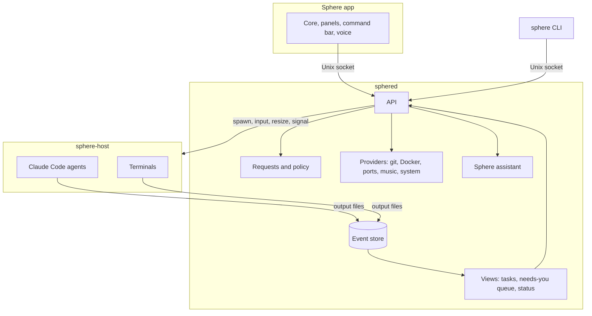

# Sphere architecture

*Second pass, 2026-10-16. It replaces the first pass (in this file's git history), so that everything goes through Sphere.*

Sphere is the one place you work. Agents, terminals, code review, containers and music all start, run and finish inside it, so you never need a Claude window or a terminal open somewhere else. Your browser and your editor (Zed) are the only things that open in their own windows, and Sphere opens them for you. Sphere has two halves:

- **The service.** `sphered` and a tiny companion, `sphere-host`, run in the background. They own the agents, the terminals, the app backends, their history and every question waiting on you.
- **The Sphere app.** A native Rust window that draws the core and the panels. It is a client of the service, like the `sphere` CLI and, later, your phone. If it closes or crashes, nothing is lost.

## What changed from the first pass

1. **Everything runs inside Sphere.** You talk to an agent in its own conversation in Sphere. When you need Claude Code's own screen, it opens in a Sphere terminal tab. "Observed sessions you start yourself" became "bring a session into Sphere".
2. **A small `sphere-host` keeps agents and terminals alive** while `sphered` restarts or updates, so an update never cuts off an agent or closes a shell.
3. **Terminals are part of the service.** Your tabs survive app restarts, and an agent's terminal is one you can open.
4. **The app's own design** is now covered: Bevy, glass panels drawn as textures, and a fast terminal renderer.
5. **Apps are adapted open source, not rebuilt.** Each runs in a Sphere panel from day one. The ones you use most later get native panels built on the same project's code.
6. **The Sphere assistant** (the command bar and voice) is designed as a client, with a rule that only you can answer requests.
7. **Milestones are re-cut around you using it daily**, with a look test first.

## Principles

1. **Everything goes through Sphere.** Every action has a home in the app, the CLI or the assistant.
2. **One source of truth.** Every change is an event in one ordered log. Task state, the step track, the needs-you queue and status lines are views computed from it.
3. **Reuse, don't rebuild.** Sphere drives your installed Claude Code with your login, settings, CLAUDE.md files, MCP servers, skills and plugins, and its apps are built on proven open-source projects.
4. **Ask you only what rules can't decide.** Most permission checks are settled inside the agent, some by Sphere's rules, and only the rest become Agent moment cards.
5. **Only you answer.** A request is answered by your click, your key or your voice through Sphere's own command parser. A model or an agent never answers one.
6. **Answer from state, not from a model.** "What's it doing?" and "what needs me?" are lookups that return in under a millisecond.
7. **Every client is equal.** The app has no private API. Anything it can do, the CLI can do through the same calls.

## Shape



## sphere-host: what keeps things alive

`sphere-host` is a deliberately tiny process that owns every child process: agents through their pipes, and terminals through their PTYs.

- It writes everything a child prints to an append-only file and keeps the child's input open.
- `sphered` talks to it over a private socket with a handful of calls: spawn, write input, close input, resize, signal, list, and read from an offset. Exits are reported with their status.
- When `sphered` restarts or updates, the host and its children keep running. `sphered` reconnects and reads on from the offsets it saved. A permission ask raised in between waits in the file and is picked up on return.
- It is installed as its own background service (a launchd agent on macOS, a systemd user unit on Linux), so restarting `sphered` can't take it down.
- It changes rarely, so its API covers pipes and PTYs from the start. Updating it is the only thing that restarts agents and shells.

## Agents

Every agent is owned by Sphere. You start one from the command bar, by voice, from the CLI, or another agent starts it.

**How Sphere drives Claude Code.** Sphere talks to Claude Code the same way Anthropic's own Agent SDKs do, as the SDK host on one pipe:

```
claude -p --input-format stream-json --output-format stream-json --verbose \
  --include-partial-messages --permission-prompt-tool stdio \
  --settings <generated> --max-budget-usd <budget> [--resume <session>]
```

- Your messages go to stdin. Every step, result and live text chunk comes back on stdout.
- Permission asks arrive as `can_use_tool` requests on the same pipe, carrying the tool, its exact input and suggested "always allow" rules. Sphere answers allow (optionally with edited input) or deny (with a message the agent reads).
- Control messages on the same pipe interrupt the agent, switch its permission mode (for example into plan mode), switch its model, report how full its context is, rewind its file changes and turn MCP servers on or off.
- Sphere's own tools for agents (`ask_human`, `start_task`, `wait`) are served on the same pipe as an in-process MCP server.
- Claude Code's first message lists its model, permission mode and slash commands, and marks the commands that only make sense in its own terminal. Sphere offers the rest, including your skills, in the command bar.

All of this was checked against the installed Claude Code (2.1.301).

**Talking to an agent.** Each task is a conversation in Sphere. You type or speak to it, interrupt it, put it in plan mode, change its model, compact it, see its context fill, and rewind it. Subagents nest under the step that started them. Working and Agent moment are views of the same conversation.

**Opening Claude Code itself.** For anything the conversation view doesn't cover yet, "Open in terminal" pauses the agent and runs Claude Code's own screen on the same session in a Sphere terminal tab. Closing the tab hands it back.

**Bringing a session into Sphere.** Claude sessions started before Sphere existed, or outside it, are listed from `claude agents --json` and the transcripts on disk. Bringing one in resumes the session under Sphere. If the outside copy is still running, Sphere asks you to stop it first.

**Idle agents.** After finishing, an agent stays warm for 10 minutes so a follow-up starts instantly, then exits. The next message resumes it. Idle agents don't count toward the concurrency limit.

**Signing in.** On start, Sphere checks `claude auth status`. If you're signed out, it runs `claude auth login` in a Sphere terminal tab.

## Terminals

The service owns every terminal: your shells, Claude Code's own screen when you open it, the open-source apps Sphere runs in panels, and later other CLI agents.

- Each terminal's PTY lives in `sphere-host`, and `sphered` keeps its screen state with `alacritty_terminal`. Any client that attaches sees the current screen at once, then live output. Keystrokes go back through the same socket.
- Closing or restarting the app doesn't kill your shells.

## Workspaces and isolation

1. **A git worktree per task**, at `~/.sphere/worktrees/<repo>/<task>` on branch `sphere/<slug>`. It sits outside your repo, so watchers, test runners and search in your checkout never see it. A repo's `.sphere/config.toml` can list untracked files to copy in (such as `.env`) and a setup command (such as `npm ci`).
2. **Claude Code's own sandbox for shell commands** (Seatbelt on macOS, bubblewrap on Linux). Sandboxed commands can write only inside the worktree and reach only allowed hosts, and they run without asking. This is the biggest single cut in how often you get asked.
3. **Containers**, opt-in later, for repos you don't trust.

**Checkpoints.** After each step that changes files, Sphere snapshots the worktree into a private git ref without touching the branch. Any step can be diffed or rolled back from Sphere, including changes made by shell commands.

**Finishing a task.** These are Sphere's own actions, not the agent's:
- **Merge** into the base branch of your checkout when it's clean, or offer a PR when it isn't.
- **Open PR**, which pushes and creates the PR. It leaves your machine, so it asks.
- **Discard**, which deletes the worktree and branch after you confirm on the card.

## Requests and policy

A request is anything waiting on you: a tool permission, a question the agent asked (`AskUserQuestion`), a plan to approve (`ExitPlanMode`), an outbound action such as sending a message or merging a PR, or a provider alert such as "minio exited, restart it?". Every request has the same shape: the exact action, the evidence, the agent's own summary, and three answers that map onto Agent moment.

- **yes**: allow, optionally with your edits. "Always" also saves the rule to Sphere's policy, and is passed to Claude Code for this session only, so nothing writes settings files into the worktree.
- **change**: deny with your words. The agent revises and asks again, and the new request carries `revises: <old id>`, so the card rewrites in place.
- **later**: the card goes back into orbit, and the agent stays paused on that one call.

The card always shows the exact command, diff or message, never only the agent's description of it. The first answer wins; a second gets `already answered`.

Policy runs in three tiers:
1. **Inside the agent.** Rules from `~/.sphere/policy.toml` and a repo's `.sphere/policy.toml` are compiled into each agent's Claude Code settings with the sandbox setup, so they're decided with no round trip.
2. **Sphere's rules**, for what needs context Claude Code doesn't have: the branch being pushed, budget left, time of day, focus mode.
3. **You**, for whatever is left.

By default, reads, searches, edits and tests inside the worktree run freely. Anything outside the worktree asks. Anything that leaves your machine (a push, a PR, a deploy, a message, a new host) always asks. Force pushes and history rewrites are denied unless you allow them when starting the task.

## Apps: adapted open source

Sphere doesn't rebuild apps that good open-source projects already do well. It adapts them to its look in two steps:

1. **Day one,** the app runs inside a Sphere panel through Sphere's terminal, with Sphere's colours and fonts.
2. **Later,** the apps you use most get native Sphere panels built on the same project's Rust code.

Sphere builds only on MIT, Apache or MPL code. GPL software only ever runs as a separate program.

| app | built on | licence | raises requests | when |
|---|---|---|---|---|
| Terminal | Alacritty's `alacritty_terminal` | Apache-2.0 | | M2 |
| Agents | Claude Code, with ideas from herdr | herdr: Apache-2.0 | permissions, questions, plans | M1, M2 |
| Editor | Zed in its own window, opened by Sphere at the right folder and line, with a Sphere theme; Helix for quick edits inside a Sphere panel | Zed runs as a separate program; Helix: MPL-2.0 | | M3 |
| Code review | delta for diffs, yazi for files, plus Sphere's checkpoints, merge, PR and discard | MIT | PRs and merges | M3 |
| Git and CI | gitui and its `asyncgit` engine, plus GitHub through your `gh` login | MIT | merges | M3 |
| Containers | oxker on `bollard`, the Docker Engine API client | MIT, Apache-2.0 | "minio exited, restart it?" | M4 |
| System | bottom | MIT | low disk | M4 |
| Ports | the OS socket table; links open in your browser | | | M4 |
| Music | spotify-player on librespot (needs Spotify Premium) | MIT | | M6 |

Each app is also a provider in the service: its own state, events, actions and watchers, sharing the log, the API and the needs-you queue with agents.

**Zed as the editor.** Zed draws with its own GPU renderer, so it can't be placed inside Sphere's 3D scene, and its editor code is GPL-3.0, so Sphere doesn't copy it. Instead Sphere keeps one Zed running in the background with a Sphere theme. Opening a file tells that window which file and line to show, so there's no startup wait, and the Sphere hotkey switches straight back.

## The Sphere assistant

The assistant is what you talk to in the command bar and by voice. It's a client of the API like any other.

- **Fast path.** Sphere's own command parser handles the common things instantly, with no model: what's running, what needs me, send it, later, make it shorter (which becomes a change), pause, stop, open the terminal, show containers, play.
- **Model path.** Anything else goes to a warm Claude session on a fast model that uses Sphere's tools: start a task, check status, run a container action, open a view. Its tool calls go through policy like any agent's.
- **It never answers a request.** "Send it" is parsed by Sphere and counts as your answer. The model can only point you at the card.
- Status lines and spoken summaries come from state, so they're instant.

## The Sphere app

- **Rust, with Bevy**, as in the first sphere. The core's ring decks are ported from the prototype as shaders, with bloom.
- **Glass panels.** Each panel's content is drawn into its own texture at full screen resolution, then placed in the 3D scene on a quad with its frame and glass. This is the native version of the prototype's floating panels, and the text stays crisp at any angle.
- **Terminal panels** use a small instanced glyph renderer that draws cells from the terminal state, the way Alacritty does.
- **Rendering** runs on its own thread at the display's refresh rate, targeting 120 Hz. Animations can be interrupted and never hold back content.
- **A global hotkey** brings Sphere up over other windows. When something needs you while it's hidden, you get an OS notification.
- It keeps nothing but layout and preferences. Everything else comes from the service.

## Event store

| kind | examples | where | replayable |
|---|---|---|---|
| durable events | task started, step, step done, request, answer, file changed, finished | SQLite (WAL mode) with one global sequence number | yes |
| bulk data | everything agents and terminals print | the host's append-only output files, referenced by offset | on request |
| live frames | typing deltas, terminal screen updates, progress ticks | memory only | no |

A client connects with `snapshot` (current tasks, the queue, status lines and the current sequence number), then calls `subscribe` from that number. Sphere replays anything newer and goes live with no gap. A client that falls too far behind is dropped and resyncs, so a slow client can't grow the service's memory.

## API

A Unix socket, user-only, speaking JSON-RPC 2.0 over newline-delimited JSON. The `sphere-client` crate wraps it with types, and the app and the CLI both use it.

- **Sync:** `snapshot`, `subscribe`, `history`, `blob.read`.
- **Agents:** `task.start`, `task.send`, `task.interrupt`, `task.set_mode`, `task.set_model`, `task.rewind`, `task.stop`, `task.open_in_terminal`, `session.list`, `session.bring_in`.
- **Requests:** `request.answer`.
- **Terminals:** `term.open`, `term.attach`, `term.input`, `term.resize`, `term.close`.
- **Projects:** `project.add`, `project.list`.
- **Later:** `task.diff`, `task.merge`, `task.pr`, `task.discard` and `editor.open` (M3); provider actions (M4 and on); `assistant.ask` (M5).

## Supervisor

- Each agent runs in its own process group. Stop withdraws pending requests, interrupts, closes the agent's input, terminates the group, and kills it after a grace period, so tests and dev servers it started end too.
- A concurrency limit (default 3) with a queue behind it.
- Budgets: per task through `--max-budget-usd`, plus a daily cap from the costs Claude Code reports. On a Claude subscription the cost is notional and your usage limits are what bite, so the app shows both.
- On start, Sphere checks `claude --version` against a tested range and warns when it's outside it.

## Restart and upgrade

- **Restarting or updating `sphered`** interrupts nothing. The host keeps agents and terminals running, and `sphered` catches up from their output files.
- **Updating `sphere-host`** (rare) restarts them. Agents resume from their saved session. A tool call cut off mid-run is rerun when it's harmless, like a test. If it left your machine, like a push or a message, it becomes a request before the task continues. Shells reopen in the same folder.
- **The app** can restart at any time without losing anything.

## Security

- The socket lives in a user-only directory, and Sphere checks the caller's user id on every connection.
- **Only you answer.** The API accepts answers only from the app and the CLI. It refuses them from any process an agent started (checked through the caller's process id; the host is a child subreaper on Linux, so detached processes stay traceable) and from the assistant. Claude Code's sandbox also stops sandboxed commands from opening Unix sockets at all. That's built in on macOS; on Linux it needs Claude Code's seccomp helper, which `sphere doctor` checks.
- Agents can't type into your terminals.
- Sphere never handles your Claude credentials. Agents use your own Claude Code login.
- The store is user-only. Known secret patterns are redacted before anything leaves the machine.
- Tool output and agent summaries are treated as untrusted text. They're shown and spoken, never executed.

## Crates

- `sphere-proto`: event, request and API types.
- `sphere-host`: the process and PTY holder.
- `sphered`: the service.
- `sphere-client`: the typed client the app and the CLI share.
- `sphere-cli`: the `sphere` command.
- `sphere-app`: the desktop app.
- `fake-claude`: a test binary that replays recorded Claude Code sessions, permission requests included.

## Testing

- Integration tests start the host and the service in temporary directories and drive them through `sphere-client` against `fake-claude`. They cover start, streaming, each answer (yes, change, later), stop, restarting `sphered` mid-run with nothing lost, and resuming after a host restart.
- Fixtures are recorded from real Claude Code sessions, one set per tested version range.
- One opt-in smoke test runs the real Claude Code on a tiny repo with a small budget.
- The app gets screenshot tests compared against the approved prototypes.

## Milestones

- **M0, the look test.** The core and one glass panel with real text, plus one live terminal panel running real programs, built in Rust and shown side by side with the prototype, with a frame-rate readout to run on your machine. This proves the riskiest part before the app is built.
- **M1, the engine.** `sphere-host` and `sphered` with owned agents, requests, policy, the store, the API, sign-in, bringing sessions in, and the CLI. It's done when `sphere run <repo> "<task>"` runs a real agent that another terminal watches and answers, and restarting `sphered` mid-run interrupts nothing.
- **M2, you can use it daily.** The Sphere app with the home screen, command bar, hotkey and notifications; the Terminal app; and Agents (starting tasks, conversations, Working, Agent moment, open in terminal).
- **M3, Code and Git.** Zed as the editor, diffs, checkpoints, merge, PR and discard; branches, PRs and CI.
- **M4, Containers, Ports and System.**
- **M5, the assistant and voice.**
- **M6, Music.**
- **Later:** other CLI agents through screen-reading rules, the phone, and containers for isolation.

## Risks

- **Matching the prototype's look in Rust.** It's the biggest unknown, so M0 tests it first.
- **The SDK host protocol isn't documented as a standalone API.** It's what Anthropic's own SDKs run on, so it's stable in practice. Version checks, per-version fixtures and tolerant parsing contain it, and pointing `--permission-prompt-tool` at an MCP tool is the fallback.
- **Sandbox gaps.** Linux needs bubblewrap and socat installed. Some dev tools don't work sandboxed (the Docker socket, browsers for end-to-end tests), so those run unsandboxed and ask, or get a rule.
- **Scope.** Nine apps is a lot, so the order puts the ones you need every day first, and adapting open source keeps each one small.

## Decisions

1. **Everything goes through Sphere.** The browser and Zed are the only windows outside it, and Sphere opens both.
2. **Two background processes**, `sphere-host` and `sphered`, so updates interrupt nothing.
3. **Apps are adapted open source**, MIT, Apache or MPL only, starting in Sphere panels and going native for the ones used most.
4. **Zed is the editor**, in its own window with a Sphere theme. Helix covers quick edits inside Sphere.
5. **The app is Rust with Bevy.**
6. **Kept from the first pass:** macOS and Linux both, Claude Code as the only agent until later, and a worktree plus the sandbox for isolation.

## Credits

Sphere builds on, or takes ideas from: [herdr](https://github.com/herdrdev/herdr) (Apache-2.0) for agent states, [Alacritty](https://github.com/alacritty/alacritty) (Apache-2.0) for terminal state, [gitui](https://github.com/gitui-org/gitui) (MIT), [oxker](https://github.com/mrjackwills/oxker) (MIT), [bollard](https://github.com/fussybeaver/bollard) (Apache-2.0), [bottom](https://github.com/ClementTsang/bottom) (MIT), [yazi](https://github.com/sxyazi/yazi) (MIT), [delta](https://github.com/dandavison/delta) (MIT), [spotify-player](https://github.com/aome510/spotify-player) (MIT), [librespot](https://github.com/librespot-org/librespot) (MIT), [Helix](https://github.com/helix-editor/helix) (MPL-2.0) and [Zed](https://github.com/zed-industries/zed), which runs as its own program.
